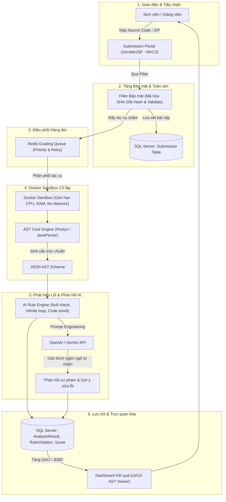
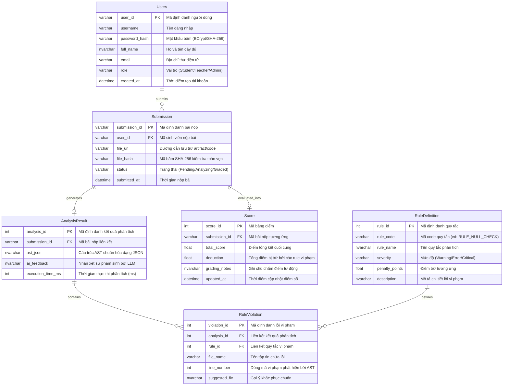

# 🚀 AITA - AI-Powered Teaching Assistant System
> **Dự án Nghiên cứu & Phát triển Trợ lý Giảng dạy Thông minh (Research-Based Learning - RBL)**  
> **Môn học:** PRJ301 - Java Web Application | **Phân ban:** Nhóm 1 – AI Static Code Analysis & AST (Tối ưu hóa thuật toán)  
> **Repository:** [rtafag/PRJ301---Group1](https://github.com/rtafag/PRJ301---Group1)

[](https://github.com/rtafag/PRJ301---Group1)
[](https://www.oracle.com/java/)
[](https://maven.apache.org/)
[](https://www.microsoft.com/sql-server/)
[](https://www.docker.com/)
[](https://redis.io/)
[](https://openai.com/)


---

## 📑 Mục lục
1. [Giới thiệu Dự án & Tầm nhìn (Project Overview)](#1-giới-thiệu-dự-án--tầm-nhìn-project-overview)
2. [Kiến trúc Kỹ thuật & Luồng Hoạt động (System Architecture)](#2-kiến-trúc-kỹ-thuật--luồng-hoạt-động-system-architecture)
3. [Mô hình Dữ liệu (Database Design - 6 Bảng ERD)](#3-mô-hình-dữ-liệu-database-design---6-bảng-erd)
4. [Phân công Vai trò Kỹ thuật Cốt lõi (5 Thành viên)](#4-phân-công-vai-trò-kỹ-thuật-cốt-lõi-5-thành-viên)
5. [Kế hoạch & Bảng Phân công Chi tiết Theo Mốc Đánh giá (Timeline)](#5-kế-hoạch--bảng-phân-công-chi-tiết-theo-mốc-đánh-giá-timeline)
   - [Peer-Review 1 (Tuần 3)](#peer-review-1-tuần-3--database-design--jwt-uiux-prototype)
   - [Peer-Review 2 (Tuần 6 - Defense lớn)](#peer-review-2-tuần-6--defense-lớn--mvc2-submission-portal-sha-256)
   - [Peer-Review 3 (Tuần 9 - Defense cuối)](#peer-review-3-tuần-9--defense-cuối--ai-integration-sandbox-grading-queue)
   - [Final Demo (Tuần 10)](#final-demo-tuần-10--báo-cáo--bảo-vệ-toàn-diện)
6. [Ánh xạ Chuẩn Đầu ra (CLO) & Barem Đánh giá (Rubrics)](#6-ánh-xạ-chuẩn-đầu-ra-clo--barem-đánh-giá-rubrics)
7. [Nguyên tắc Phối hợp & Văn hóa Đánh giá Đồng đẳng (École 42)](#7-nguyên-tắc-phối-hợp--văn-hóa-đánh-giá-đồng-đẳng-école-42)
8. [Hướng dẫn Cài đặt & Vận hành Thử nghiệm (Getting Started)](#8-hướng-dẫn-cài-đặt--vận-hành-thử-nghiệm-getting-started)

---

## 1. Giới thiệu Dự án & Tầm nhìn (Project Overview)

### 1.1. Bối cảnh & Vấn đề giải quyết
* **Vấn đề cốt lõi:** Hiện tượng **Burnout (kiệt sức)** của giảng viên Công nghệ Thông tin khi phải đối mặt với khối lượng khổng lồ bài nộp thực hành lập trình trong mỗi học kỳ. Việc chấm điểm thủ công tốn nhiều công sức nhưng phản hồi tới sinh viên thường bị chậm trễ và thiếu chiều sâu giải thích logic.
* **Tầm nhìn AITA:** Là sự giao thoa hoàn hảo giữa nền tảng **Java Web truyền thống (Syllabus PRJ301 - Servlet, JSP, MVC2, JDBC)** và các **công nghệ tính toán tiên tiến (AST, Roslyn, Docker Sandbox, AI LLMs, Redis Queue)**. Hệ thống chuyển đổi mô hình từ quản lý học tập thụ động thành **Trợ lý giảng dạy chủ động (Active AI Teaching Assistant)**.

### 1.2. Phân ban Nghiên cứu: Nhóm 1 – AI Static Code Analysis & AST
* **Mục tiêu chuyên sâu:** Xây dựng bộ phân tích mã nguồn tĩnh (Static Analysis Engine) bóc tách cấu trúc cú pháp thành **Cây cú pháp trừu tượng (Abstract Syntax Tree - AST)** để phát hiện triệt để các lỗi logic, bẫy tiềm ẩn và code smell mà **không cần thực thi mã nguồn**.
* **Công nghệ cốt lõi:**
  - Thư viện bóc tách cú pháp: **Roslyn / AST Visitor Parser**.
  - Chuẩn hóa trung gian: **JSON Schema** liên kết giữa Core Engine, Database, Rule Engine và UI.
  - Trí tuệ nhân tạo: **OpenAI / Google Gemini API** để chuyển hóa các lỗi cú pháp/logic thành phản hồi sư phạm tự nhiên, dễ tiếp thu cho sinh viên.
  - Bảo mật & hạ tầng: **Docker Sandbox cô lập (Resource Limits)**, nén ZIP, băm bảo mật **SHA-256**, hàng đợi **Redis Priority & Retry Queue**.

---

## 2. Kiến trúc Kỹ thuật & Luồng Hoạt động (System Architecture)

Luồng xử lý từ lúc nộp bài đến khi xuất kết quả phân tích và chấm điểm:



---

## 3. Mô hình Dữ liệu (Database Design - 6 Bảng ERD)

Dự án triển khai chuẩn hóa cơ sở dữ liệu trên **Microsoft SQL Server** với đầy đủ **6 thực thể quan hệ** phục vụ toàn bộ chu trình nộp, phân tích cú pháp, ghi nhận vi phạm và tính điểm:



---

## 4. Phân công Vai trò Kỹ thuật Cốt lõi (5 Thành viên)

Mỗi thành viên phụ trách độc lập một mảng kỹ thuật chuyên sâu xuyên suốt 10 tuần, ánh xạ trực tiếp đến các tiêu chí đánh giá trong Rubric PRJ301:

| Thành viên | Vai trò Kỹ thuật | Mảng Phụ trách Chính (Kỹ thuật) | Ánh xạ Rubric |
| :--- | :--- | :--- | :--- |
| **TV1** | **AST Core Engine Lead**<br>*(Trưởng nhóm)* | • Module lõi dùng Roslyn parse mã nguồn (C#/Java) thành AST, viết Syntax Visitor.<br>• Chuẩn hóa output (JSON schema) cho Rule Engine, Database, UI tiêu thụ.<br>• Điều phối tiến độ chung, tổng hợp công việc trước mỗi buổi Peer-Review. | **Application (Use of Concepts)**<br>*(25 điểm)* |
| **TV2** | **Backend & Database Engineer** | • Thiết kế ERD chuẩn hóa 6 bảng: `Users`, `Submission`, `AnalysisResult`, `RuleViolation`, `RuleDefinition`, `Score`.<br>• Tạo Database & Table thật trong Microsoft SQL Server (SSMS), chuẩn hóa CSDL, xây dựng tầng DAO/JDBC.<br>• Triển khai xác thực JWT Authentication, sinh dữ liệu mẫu (Sample data). | **Database Design**<br>*(10 điểm)* |
| **TV3** | **AI Rule / Detection Engineer** | • Xây dựng bộ quy tắc phát hiện lỗi logic trên AST (Null check, vòng lặp vô hạn, code smell).<br>• Tích hợp OpenAI/Gemini API để diễn giải lỗi kỹ thuật thành phản hồi tự nhiên dễ hiểu.<br>• Xây dựng bộ Test case cho từng rule, phối hợp cùng TV1 chuẩn hóa luồng input/output. | **AI Integration**<br>*(10 điểm)* |
| **TV4** | **Web / MVC2 Frontend Engineer** | • Xây dựng Submission Portal (Servlet/JSP, MVC2 Pattern, Filter, Expression Language).<br>• Phát triển Dashboard trực quan hóa kết quả AST: danh sách lỗi, mức độ nghiêm trọng, vị trí dòng, gợi ý sửa.<br>• Thiết kế Wireframe/UI Prototype, Use-case Diagram và kiểm thử đa luồng người dùng. | **User Interface (UI/UX)**<br>*(10 điểm)* |
| **TV5** | **Integration & QA/DevOps Engineer** | • Xây dựng môi trường Docker Sandbox cô lập, thiết lập Resource Limits (CPU/Memory).<br>• Xác thực tính toàn vẹn file bằng SHA-256 hash; quản lý hàng đợi Redis (Priority & Retry).<br>• Kiểm thử tích hợp End-to-End (E2E), đóng gói Release Package, hoàn thiện Report & Demo. | **Sandbox (30% PR)**,<br>**Report (5đ)**, **Demo (5đ)** |

---

## 5. Kế hoạch & Bảng Phân công Chi tiết Theo Mốc Đánh giá (Timeline)

### 📌 Peer-Review 1 (Tuần 3) — Database Design & JWT, UI/UX Prototype

| TV | Việc phải LÀM (Trước buổi Peer-Review) | Nội dung phải THUYẾT TRÌNH (≈ 4–5 phút/người) |
| :---: | :--- | :--- |
| **TV1** | • Tổng hợp kiến trúc hệ thống AITA (sơ đồ khối), xác định luồng dữ liệu liên thông AST → DB → UI.<br>• Lên kế hoạch chi tiết cho AST Core Engine (định nghĩa chuẩn input/output dự kiến). | • Thuyết trình kiến trúc tổng thể hệ thống & vai trò cốt lõi của module AST trong toàn bộ pipeline.<br>• Kế hoạch triển khai AST Core Engine trong 5 tuần tới. |
| **TV2** | • Vẽ ERD hoàn chỉnh 6 bảng (`Users`, `Submission`, `AnalysisResult`, `RuleViolation`, `RuleDefinition`, `Score`).<br>• Tạo Database & Table thật trong SQL Server (chạy script thật trong SSMS, không chỉ vẽ trên giấy).<br>• Cài đặt JWT Authentication cơ bản, viết script sample data phục vụ kiểm thử. | • Thuyết trình cấu trúc ERD 6 bảng & giải thích cơ sở lựa chọn các quan hệ dữ liệu.<br>• **Demo trực tiếp Database/Table đã tạo trong SQL Server (SSMS)**.<br>• Trình bày và demo cơ chế đăng nhập với JWT Authentication. |
| **TV3** | • Khảo sát & liệt kê danh sách quy tắc lỗi logic dự kiến phát hiện trên AST.<br>• Thử nghiệm kết nối và gọi API OpenAI/Gemini với bộ dữ liệu mẫu (Prompt Engineering thử nghiệm). | • Báo cáo danh sách rule dự kiến & tiêu chí đánh giá độ chính xác của phân tích tĩnh.<br>• Trình bày kết quả thử nghiệm gọi AI API đầu tiên và định dạng phản hồi. |
| **TV4** | • Thiết kế UI/UX Prototype cho giảng viên & sinh viên (Wireframe chi tiết).<br>• Vẽ sơ đồ Use-case Diagram cho Submission Portal (các tác nhân: Sinh viên, Giảng viên, Hệ thống AI).<br>• Xác định luồng điều hướng người dùng (User Flow) của Submission Portal. | • Thuyết trình UI/UX Prototype (Wireframe) & luồng người dùng (User Flow).<br>• Phân tích Use-case Diagram: các tác nhân và chức năng chính.<br>• Báo cáo phản hồi thu thập được và các điểm điều chỉnh giao diện. |
| **TV5** | • Khởi tạo Repository GitHub, cấu hình môi trường dự án, thiết lập CI cơ bản.<br>• Lập kế hoạch thiết lập Docker Sandbox & chiến lược bảo mật hệ thống tổng thể. | • Giới thiệu cấu trúc Repository & quy tắc làm việc chung của nhóm (Branching strategy, commit convention).<br>• Kế hoạch triển khai Docker Sandbox & các rào cản giới hạn tài nguyên (Resource Limits). |

---

### 📌 Peer-Review 2 (Tuần 6 — Defense lớn) — MVC2, Submission Portal, SHA-256

| TV | Việc phải LÀM (Trước buổi Peer-Review) | Nội dung phải THUYẾT TRÌNH (≈ 4–5 phút/người) |
| :---: | :--- | :--- |
| **TV1** | • Hoàn thiện AST Core Engine parse thử nghiệm với Roslyn.<br>• Chuẩn hóa dữ liệu output thành JSON Schema; viết Syntax Visitor duyệt cây mã nguồn. | • **Demo AST Core Engine:** bóc tách trực tiếp một đoạn code thật ra định dạng JSON schema.<br>• Trình bày phương thức chuyển giao schema để Rule Engine (TV3) và UI (TV4) tiêu thụ. |
| **TV2** | • Hoàn thiện tầng DAO/JDBC kết nối vào Database SQL Server đã tạo ở PR1.<br>• Chuẩn bị dữ liệu mẫu chuẩn hóa phục vụ demo chu trình MVC2 hoàn chỉnh. | • Demo tầng DAO/JDBC hoàn chỉnh: chứng minh Submission Portal ghi/đọc dữ liệu chính xác trên SQL Server.<br>• Giải thích cấu trúc dữ liệu mẫu dùng cho demo. |
| **TV3** | • Xây dựng quy tắc đầu tiên phát hiện lỗi logic trên AST (Null check, vòng lặp vô hạn).<br>• Viết bộ test case kiểm thử độ chính xác cho rule vừa xây dựng. | • **Demo Rule Engine v1:** phát hiện chính xác lỗi trên một tập tin code mẫu.<br>• Báo cáo kết quả kiểm thử test case và tỉ lệ nhận diện sai (false positive). |
| **TV4** | • Hoàn thiện Submission Portal hoàn chỉnh (áp dụng kiến trúc Servlet/JSP, MVC2, Filter, Expression Language).<br>• Cấu hình tầng Filter để kiểm tra bảo mật trước khi cho phép nộp bài. | • **Demo Submission Portal:** nộp bài hoàn chỉnh từ giao diện web cho đến khi lưu trữ vào Database.<br>• Phân tích cơ chế Filter bảo mật và xác thực tầng MVC2. |
| **TV5** | • Triển khai cơ chế nén tệp tin ZIP & tính toán mã băm SHA-256 khi sinh viên nộp bài.<br>• Tích hợp với tầng Filter nhằm cưỡng bức kiểm tra mã băm SHA-256 ngay khi nhận bài nộp. | • **Demo luồng nén ZIP + xác thực SHA-256** khi nộp bài.<br>• Giải thích lý do bước này đảm bảo tính toàn vẹn mã nguồn trước khi đưa vào hàng đợi xử lý AI. |

---

### 📌 Peer-Review 3 (Tuần 9 — Defense cuối) — AI Integration, Sandbox, Grading Queue

| TV | Việc phải LÀM (Trước buổi Peer-Review) | Nội dung phải THUYẾT TRÌNH (≈ 4–5 phút/người) |
| :---: | :--- | :--- |
| **TV1** | • Hoàn thiện tích hợp AST Core Engine với Rule Engine của TV3.<br>• Xử lý triệt để các ca mã nguồn phức tạp, đa tệp tin (multi-file compilation/parsing). | • **Demo AST Core Engine hoàn chỉnh** kết hợp nhịp nhàng với Rule Engine.<br>• Báo cáo các thách thức kỹ thuật chuyên sâu và giải pháp giải quyết trong quá trình tích hợp. |
| **TV2** | • Triển khai tầng JPA/ORM phục vụ quản lý dữ liệu tiến trình chấm (Grading Job).<br>• Đảm bảo tính nhất quán và đồng bộ dữ liệu giữa 3 bảng: `Submission`, `AnalysisResult`, `Score`. | • Thuyết trình tầng JPA/ORM phục vụ hàng đợi Grading Job Queue.<br>• Trình bày cơ chế lưu trữ, cập nhật và truy xuất dữ liệu chấm điểm tự động. |
| **TV3** | • Hoàn thiện tích hợp AI Feedback (OpenAI/Gemini API) diễn giải các vi phạm logic.<br>• Tối ưu hóa câu lệnh nhắc (Prompt Engineering) nhằm giảm thiểu false positive và tăng tính sư phạm. | • **Demo phản hồi AI:** chuyển hóa các mã lỗi kỹ thuật khô khan thành lời giải thích ngôn ngữ tự nhiên dễ hiểu.<br>• Báo cáo số liệu thực nghiệm cải thiện độ chính xác của rule qua các vòng thử nghiệm. |
| **TV4** | • Hoàn thiện Dashboard hiển thị kết quả phân tích AST chi tiết (danh mục lỗi, mức độ, gợi ý sửa).<br>• Kiểm thử tương tác giao diện người dùng trên nhiều luồng tác vụ song song. | • **Demo Dashboard hoàn chỉnh:** toàn bộ luồng từ lúc nộp bài đến khi hiển thị kết quả phân tích trực quan.<br>• Trình bày các cải tiến trải nghiệm người dùng (UX) so với phiên bản Peer-Review 2. |
| **TV5** | • Triển khai Docker Sandbox với chính sách giới hạn tài nguyên (Resource Limits) nghiêm ngặt.<br>• Kết nối hàng đợi Grading Job Queue qua Redis (hỗ trợ Priority & Retry); kiểm thử tích hợp E2E. | • **Demo Docker Sandbox:** chạy phân tích mã nguồn an toàn trong môi trường cách ly.<br>• **Demo hàng đợi Redis:** xử lý nhiều submission đồng thời có cơ chế ưu tiên và thử lại. |

---

### 📌 Final Demo (Tuần 10) — Báo cáo & Bảo vệ Toàn diện

| TV | Việc phải LÀM (Trước buổi Final Demo) | Nội dung phải THUYẾT TRÌNH (≈ 4–5 phút/người) |
| :---: | :--- | :--- |
| **TV1** | • Tổng hợp toàn bộ hệ thống; chuẩn bị kịch bản (script) mở đầu và kết luận buổi bảo vệ.<br>• Rà soát gói phát hành (Release Package) hoàn chỉnh cùng các thành viên. | • Giới thiệu tổng quan hệ thống AITA & module AST Core Engine (Mở đầu Demo).<br>• Trực tiếp trả lời Q&A chuyên sâu về kiến trúc tổng thể & AST Engine. |
| **TV2** | • Kiểm tra toàn diện tính toàn vẹn dữ liệu và tính ổn định kết nối trước Demo. | • Demo phần Database Design, cấu trúc bảng SQL Server & tầng DAO/JDBC khi được yêu cầu.<br>• Trực tiếp trả lời Q&A về thiết kế ERD, cơ chế JWT và tầng truy cập dữ liệu DAO. |
| **TV3** | • Chuẩn bị sẵn các kịch bản lỗi code mẫu tiêu biểu nhất để demo tính năng AI Feedback. | • Demo trực tiếp Rule Engine kết hợp phản hồi từ AI trên mã nguồn mẫu.<br>• Trực tiếp trả lời Q&A về giải pháp tích hợp AI & kỹ thuật Prompt Engineering. |
| **TV4** | • Chuẩn bị luồng demo giao diện người dùng mượt mà (cả phân hệ Giảng viên và Sinh viên). | • Demo trực tiếp luồng thao tác trên Submission Portal & giao diện Dashboard kết quả.<br>• Trực tiếp trả lời Q&A về thiết kế UI/UX và việc tuân thủ mô hình MVC2. |
| **TV5** | • Hoàn thiện báo cáo kỹ thuật cuối cùng (Report); tổng duyệt kịch bản demo và phương án xử lý rủi ro. | • Demo Docker Sandbox & hàng đợi Redis chịu tải khi có nhiều bài nộp đồng thời.<br>• Trực tiếp trả lời Q&A về tiêu chuẩn Sandbox Compliance và nội dung Report. |

---

## 6. Ánh xạ Chuẩn Đầu ra (CLO) & Barem Đánh giá (Rubrics)

### 6.1. Bảng Ma trận Đối chiếu Chuẩn đầu ra (CLO Mapping Matrix)

| Mã Chuẩn Đầu Ra | Nội Dung Chuẩn Đầu Ra (PRJ301) | Hoạt Động Kỹ Thuật Dự Án AITA & Tiêu Chí Đo Lường |
| :--- | :--- | :--- |
| **CLO1 – CLO3** | Thiết kế và vận hành Cơ sở dữ liệu / JDBC | • Thể hiện qua sơ đồ ERD chuẩn hóa 6 bảng.<br>• Tạo bảng thật trong SQL Server và thực thi truy xuất dữ liệu an toàn qua tầng DAO/JDBC. |
| **CLO4 – CLO6** | Ứng dụng mô hình Web MVC2 / Servlet / JSP | • Xây dựng Submission Portal và Dashboard quản trị theo đúng chuẩn MVC2.<br>• Ứng dụng Filter bảo mật, JSP, JSTL và Expression Language (EL). |
| **CLO7 – CLO9** | Bảo mật Web & Công nghệ nâng cao | • Cơ chế xác thực mã băm SHA-256 chống giả mạo.<br>• Đóng gói thực thi trong Docker Sandbox cô lập tài nguyên.<br>• Tích hợp hàng đợi Redis và Pipeline AI phân tích AST an toàn. |

---

### 6.2. Cơ cấu Barem Điểm Đánh giá Môn học (PRJ301/302 Evaluation Rubric - 100 Điểm)

| Tiêu chí Đánh giá | Trọng số | Chi tiết Yêu cầu Đạt Điểm Tối đa | Phụ trách Chính |
| :--- | :---: | :--- | :---: |
| **Database Design** | **10đ** | • 5–6 bảng chuẩn hóa quan hệ rõ ràng (10 pts).<br>• Cài đặt hoàn chỉnh trong SQL Server kèm dữ liệu mẫu (5 pts).<br>• Sơ đồ quan hệ ERD mạch lạc, chuẩn xác (5 pts). | **TV2** |
| **Business Logic Implementation** | **10đ** | • Luồng nghiệp vụ rõ ràng, kèm Use-case Diagram chi tiết (5 pts).<br>• Kiểm tra và xác thực dữ liệu đầu vào (Input Validation chặt chẽ) (5 pts). | **TV4, TV5** |
| **User Interface (UI/UX)** | **10đ** | • Giao diện thân thiện, trực quan, hỗ trợ giảng viên và sinh viên (5 pts).<br>• Điều hướng mượt mà, logic giữa các trang chức năng (5 pts). | **TV4** |
| **Contents (Project Quality - RBL)** | **25đ** | • Hệ thống hoàn chỉnh ở mức cao, tích hợp công nghệ tiên tiến (AI, API, AST).<br>• Tài liệu kỹ thuật chi tiết, logic rõ ràng, mã nguồn cấu trúc tốt. | **Cả nhóm** |
| **Application (Use of Concepts)** | **25đ** | • Ứng dụng chuẩn mực mô hình MVC2, Servlet, JavaBeans, JDBC tối ưu.<br>• Quản lý Session chặt chẽ, xử lý ngoại lệ toàn diện, kiến trúc Module hóa. | **TV1, TV2, TV4** |
| **AI Integration** | **10đ** | • Tính năng AI hoạt động mượt mà, phản hồi có giá trị sư phạm cao (10 pts).<br>• Giải thích rõ ràng thuật toán, luồng prompt và tiêu chí đánh giá (5 pts). | **TV3** |
| **Report & Documentation** | **5đ** | • Báo cáo học thuật chỉn chu: yêu cầu hệ thống, kiến trúc thiết kế, chức năng, AI (5 pts). | **TV5** |
| **Demo & Q&A** | **5đ** | • Buổi demo vận hành trơn tru; cả 5 thành viên tự tin trả lời chất vấn phản biện (5 pts). | **Cả 5 TV** |
| **TỔNG CỘNG** | **100đ** | **Đảm bảo 50% trọng số đặt vào Contents & Application nhằm kích thích tư duy nghiên cứu (RBL).** | |

---

### 6.3. Barem Chấm chéo Đồng đẳng (Peer-Review Rubric)

Tại mỗi buổi Peer-Review, bài làm sẽ được chấm chéo xoay vòng theo 3 trụ cột:

| Trụ cột Đánh giá | Trọng số | Tiêu chí Chi tiết & Phân công Bảo vệ |
| :--- | :---: | :--- |
| **Sandbox Compliance** | **30%** | • Khả năng biên dịch và chạy ổn định trong môi trường Docker Sandbox cách ly, không kết nối mạng.<br>• **Trách nhiệm:** TV5 chủ trì kỹ thuật; tuy nhiên **mọi thành viên** đều phải giải thích được luồng dữ liệu của module mình đi qua Sandbox như thế nào khi ban chấm chéo đặt câu hỏi. |
| **MVC2 / Clean Code** | **40%** | • Tuân thủ triệt để mô hình MVC2, tính đúng đắn của cấu trúc Package và cơ chế mã hóa SHA-256 cho artifact bài nộp.<br>• **Trách nhiệm:** TV4 (MVC2/UI) + TV2 (Cấu trúc dữ liệu & DAO) + TV5 (SHA-256 Hash Filter); mỗi người tự bảo vệ đoạn mã mình trực tiếp triển khai. |
| **Peer Defense** | **30%** | • Khả năng phản biện, bảo vệ giải pháp kỹ thuật và trả lời chất vấn Q&A trong 15 phút.<br>• **Trách nhiệm:** **Cả 5 thành viên cùng tham gia**; mỗi người tự bảo vệ phần việc của mình, Trưởng nhóm TV1 chỉ đóng vai trò điều phối thứ tự phát biểu. |

---

## 7. Nguyên tắc Phối hợp & Văn hóa Đánh giá Đồng đẳng (École 42)

Nhóm cam kết tuân thủ các nguyên tắc kỷ luật học thuật sau đây:

1. **Nguyên tắc Bình đẳng Thuyết trình:**
   - Cả 5 thành viên **bắt buộc** phải trực tiếp làm việc và thuyết trình phần việc của mình tại **MỌI** buổi Peer-Review (PR1, PR2, PR3) và Final Demo.
   - Tuyệt đối không có thành viên nào chỉ "ngồi nghe" hoặc để một mình Trưởng nhóm (TV1) gánh vác việc thuyết trình.
   - Mỗi thành viên trình bày phần việc mình làm trong khoảng **4–5 phút**, đúng chuyên môn kỹ thuật được phân công, và tự mình trả lời câu hỏi phản biện từ ban chấm chéo.
2. **Vai trò Trưởng nhóm (TV1):**
   - Chỉ đảm nhận mở đầu, kết nối các phần trình bày và tổng kết buổi bảo vệ — **không thuyết trình thay** nội dung kỹ thuật của thành viên khác.
   - Tổng hợp tiến độ hàng tuần và nhắc nhở các thành viên chuẩn bị tài liệu, slide và kịch bản demo trước mỗi mốc đánh giá.
3. **Cơ chế Hỗ trợ Kỹ thuật & Điểm Sửa lỗi (Correction Points):**
   - Vào các tuần cao điểm (Tuần 6, Tuần 9), các thành viên có thể hỗ trợ chéo nhau về mặt kỹ thuật, nhưng phần thuyết trình và trả lời Q&A vẫn phải do chính người phụ trách module thực hiện.
   - Tích cực tham gia chấm chéo các nhóm bạn đúng tinh thần văn hóa École 42 nhằm tích lũy Correction Points.
4. **Cam kết Tiêu chuẩn Kỹ thuật:**
   - Cơ sở dữ liệu phải có đủ **6 bảng chuẩn hóa** (không dừng lại ở 4 bảng giản lược).
   - TV2 tạo Database và Table thật trên **Microsoft SQL Server (SSMS)** kèm dữ liệu mẫu hoàn chỉnh (không chỉ dùng script mẫu).
   - TV4 cung cấp đầy đủ **Use-case Diagram** bên cạnh sơ đồ luồng người dùng (User Flow) cho Submission Portal.

---

## 8. Hướng dẫn Cài đặt & Vận hành Thử nghiệm (Getting Started)

### 8.1. Yêu cầu Môi trường (Prerequisites)
* **Java Development Kit (JDK):** Phiên bản 11 trở lên.
* **Apache Maven:** 3.8+.
* **Database:** Microsoft SQL Server (2019/2022 hoặc Azure SQL Edge).
* **Containerization:** Docker Desktop.
* **IDE:** IntelliJ IDEA / Eclipse / VS Code kèm Java Extension Pack.

### 8.2. Cấu trúc Dự án Hiện tại
```text
PRJ301---Group1/
├── data/                         # Dữ liệu mẫu khởi tạo CSDL (.csv)
│   ├── users.csv                 # Dữ liệu tài khoản người dùng
│   ├── submission.csv            # Dữ liệu bài nộp thử nghiệm
│   ├── rule_definition.csv       # Danh mục các quy tắc phân tích
│   ├── analysis_result.csv       # Kết quả phân tích mẫu
│   ├── rule_violation.csv        # Danh sách lỗi vi phạm mẫu
│   └── score.csv                 # Điểm số mẫu
├── src/main/java/com/group1/
│   ├── dao/                      # Tầng DAO (UsersDAO, SubmissionDAO, ScoreDAO, ...)
│   ├── model/                    # Tầng Model (6 thực thể chuẩn hóa)
│   ├── util/                     # Hỗ trợ đọc CSV, băm SHA-256, DBContext
│   ├── DataGenerator.java        # Tiện ích sinh dữ liệu mẫu
│   └── Main.java                 # Chương trình kiểm tra kết nối & nạp DB
├── generate_models.py            # Script tự động hóa sinh Model & DAO
├── fix_sql.ps1                   # Script hỗ trợ bật TCP/IP cho SQL Server
├── pom.xml                       # Quản lý dependencies (mssql-jdbc, ...)
└── README.md                     # Tài liệu kiến trúc dự án & timeline
```

### 8.3. Khởi tạo Cơ sở Dữ liệu & Chạy Thử
1. **Clone mã nguồn từ GitHub:**
   ```powershell
   git clone https://github.com/rtafag/PRJ301---Group1.git
   cd PRJ301---Group1
   ```
2. **Kiểm tra dịch vụ SQL Server:** Đảm bảo SQL Server đang chạy và cổng `1433` (TCP/IP) đã được kích hoạt (có thể chạy file [fix_sql.ps1](file:///c:/Users/ADMIN/.gemini/antigravity/scratch/PRJ301---Group1/fix_sql.ps1) bằng quyền Administrator nếu gặp sự cố cổng TCP).
3. **Cấu hình chuỗi kết nối:** Mở tệp [Main.java](file:///c:/Users/ADMIN/.gemini/antigravity/scratch/PRJ301---Group1/src/main/java/com/group1/Main.java) và cập nhật tài khoản kết nối CSDL (mặc định: `sa` / mật khẩu quản trị).
4. **Biên dịch và chạy thử:**
   - **Cách 1: Sử dụng Java trực tiếp (đã có sẵn `mssql-jdbc.jar` trong repo):**
     ```powershell
     # Tạo thư mục output nếu chưa có
     New-Item -ItemType Directory -Force -Path target/classes
     
     # Biên dịch mã nguồn với mã hóa UTF-8
     javac -encoding UTF-8 -cp ".;mssql-jdbc.jar" -d target/classes (Get-ChildItem -Recurse src/main/java/*.java | ForEach-Object { $_.FullName })
     
     # Thực thi chương trình
     java -cp "target/classes;mssql-jdbc.jar" com.group1.Main
     ```
   - **Cách 2: Sử dụng Apache Maven (nếu môi trường đã cài `mvn`):**
     ```powershell
     mvn clean compile
     mvn exec:java -Dexec.mainClass="com.group1.Main"
     ```
5. **Kiểm tra kết quả:** Màn hình console sẽ thông báo `Connected to SQL Server!` thành công và hiển thị các bản ghi điểm số mẫu từ bảng `Score`.

---
*Bản quyền tài liệu thuộc về **Nhóm 1 – PRJ301 (AITA Project)** | Lưu trữ tại GitHub: [rtafag/PRJ301---Group1](https://github.com/rtafag/PRJ301---Group1). Được cập nhật và hoàn thiện theo Đề cương chi tiết 10 tuần và Rubric Đánh giá Học thuật.*