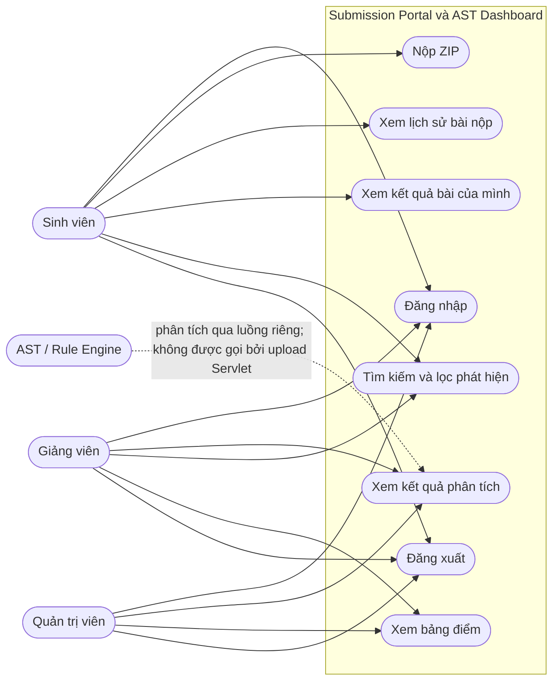

# TV4 - UI/UX, Use-case và User Flow

## Mục tiêu và phạm vi

Tài liệu mô tả giao diện Servlet/JSP, vai trò, luồng thao tác và tiêu chí kiểm thử TV4. Giao diện dùng HTML/CSS responsive, Servlet làm controller, DAO/JDBC truy cập SQL Server, JSP/JSTL/EL hiển thị dữ liệu.

## Use-case diagram



## Wireframe

### Trang chủ sau đăng nhập

```text
+------------------------------------------------------------------+
| AITA                                      Xin chào, {họ tên}     |
+------------------------------------------------------------------+
| BẢNG ĐIỀU KHIỂN                                                   |
|                                                                  |
| [ Cổng nộp bài ] [ Kết quả phân tích AST ]    (Sinh viên)         |
| [ Kết quả phân tích AST ] [ Bảng điểm ]      (Giảng viên/Admin)  |
|                                                                  |
| Thống kê toàn hệ thống chỉ hiển thị cho Giảng viên/Admin.        |
|                                                   [ Đăng xuất ]  |
+------------------------------------------------------------------+
```

### Cổng nộp bài dành cho sinh viên

```text
+------------------------------------------------------------------+
| Điều hướng: [Trang chủ] [Cổng nộp bài] [Kết quả AST] [Đăng xuất]|
+------------------------------------------------------------------+
| CỔNG NỘP BÀI                                                     |
| Chỉ chấp nhận ZIP hợp lệ, tối đa 10 MB.                          |
| [ Chọn tệp .zip ]                                 [ Nộp bài ]    |
| Trạng thái upload / thông báo lỗi                                 |
|                                                                  |
| LỊCH SỬ NỘP                                                      |
| Mã bài nộp             Trạng thái               Thời gian        |
| SUB-...                Submitted                ...              |
+------------------------------------------------------------------+
```

### Dashboard kết quả

```text
+------------------------------------------------------------------+
| Điều hướng theo vai trò: [Trang chủ] [Cổng nộp bài/Bảng điểm]   |
+------------------------------------------------------------------+
| KẾT QUẢ PHÂN TÍCH AST                                            |
| [ Lọc severity v ] [ Tìm rule / tệp / mô tả... ]  x / y phát hiện|
|                                                                  |
| BÀI NỘP SUB-...                            Thời gian phân tích    |
| Nhận xét tổng quan                                               |
| [Critical] Rule - tệp.java, dòng 12 - trừ điểm                   |
| Mô tả lỗi                                                       |
| Gợi ý sửa                                                       |
+------------------------------------------------------------------+
```

## Luồng thao tác

### Sinh viên

1. Mở `/login`, đăng nhập; Servlet tạo session cho tài khoản đã xác thực.
2. Ở trang chủ, chọn **Cổng nộp bài**. Filter chỉ cho phép session có `Users` role Student và `userId` trùng khớp.
3. GET portal tạo/lấy CSRF token; JSP gửi token bằng `X-CSRF-Token` header để Filter xác thực mà không cần đọc multipart body.
4. Filter kiểm tra token trước khi controller đọc tệp. Controller giới hạn kích thước, chỉ chấp nhận ZIP, kiểm tra đường dẫn entry và kích thước giải nén, băm SHA-256, từ chối hash trùng, lưu artifact và ghi Submission.
5. Portal hiển thị mã bài nộp và lịch sử. Sinh viên mở **Kết quả phân tích AST** để xem kết quả đã có; query chỉ lấy submission của user hiện tại.
6. Sinh viên lọc severity/tìm kiếm và đọc tệp, dòng, mô tả, điểm trừ và gợi ý sửa.

### Giảng viên / quản trị viên

1. Đăng nhập trong browser profile riêng.
2. Mở dashboard AST để xem các kết quả đã lưu, lọc/tìm kiếm findings; mở **Bảng điểm** để xem điểm.
3. Thử mở `/student/submissions`: Filter từ chối truy cập với vai trò không phải sinh viên.
4. Đăng xuất để hủy session.

### Luồng lỗi và an toàn

- Khách chưa đăng nhập được chuyển đến trang login khi mở trang; POST không hợp lệ bị từ chối.
- Sai role, sai session identity, CSRF header sai/thiếu, request method không được hỗ trợ và ZIP không hợp lệ đều bị từ chối trước khi lưu. CSRF header được kiểm tra trước khi `Sha256Filter` đọc multipart body.
- Nội dung từ DB được xuất bằng JSTL `c:out`; các trang có dữ liệu người dùng đặt `Cache-Control: no-store`.
- Lỗi kết nối DB được ném thành Servlet error thay vì trả về dashboard thành công với số liệu rỗng.

> **Ranh giới tích hợp:** Servlet upload hiện ghi nhận artifact và trạng thái `Submitted`; nó chưa gửi job sang Redis/AST worker. Kết quả trên dashboard là các phân tích đã có sẵn trong SQL Server. Vì vậy, để demo dashboard hãy dùng dữ liệu mẫu đã liên kết; không kỳ vọng ZIP vừa upload sẽ tự động sinh AST.

## Ma trận kiểm thử

| Vai trò / tình huống | Cổng nộp bài | Dashboard AST | Bảng điểm | Kiểm thử tự động |
|---|---|---|---|---|
| Khách | POST bị từ chối | Chuyển đến login | Chuyển đến login | HTTP E2E và controller tests |
| Sinh viên | Nộp ZIP hợp lệ; ZIP trùng bị từ chối | Chỉ thấy bài của mình | Bị từ chối | HTTP E2E và controller tests |
| Giảng viên | Bị từ chối | Xem kết quả đã lưu | Được phép xem | HTTP E2E và controller tests |
| Admin | Bị từ chối | Xem kết quả đã lưu | Được phép xem | HTTP E2E và controller tests |
| Session identity không khớp | - | Bị từ chối | - | Home/dashboard controller tests |
| CSRF sai/thiếu, ZIP lỗi | Bị từ chối, không lưu | - | - | HTTP E2E |

`SubmissionServletE2ETest`, `AnalysisDashboardControllerTest` và `DashboardAccessTest` kiểm thử các nhánh HTTP/role/CSRF/ownership. Demo thủ công nên dùng hai browser profile riêng để mô phỏng hai session song song.

## Ghi nhận phản hồi UX

Chưa có phiên thử nghiệm với người dùng bên ngoài trong môi trường này; không gán phản hồi giả cho sinh viên/giảng viên. Rà soát nội bộ theo các luồng trên đã dẫn đến các điều chỉnh: thống kê tổng hợp chỉ hiện cho giảng viên/admin, lỗi DB không bị biến thành trang thành công rỗng, liên kết điều hướng theo role và thông báo upload/bộ lọc có vùng `aria-live`. Để hoàn tất đánh giá người dùng trực tiếp, ghi phản hồi thật vào bảng sau:

| Ngày | Vai trò (không ghi thông tin cá nhân) | Luồng đã thử | Vấn đề/phản hồi | Điều chỉnh | Trạng thái |
|---|---|---|---|---|---|
| Chưa thực hiện | - | Student + Teacher | Cần thử với người dùng thật | Chờ phản hồi | Pending |

## Tiêu chí demo TV4

- Dùng hai tài khoản và hai browser profile, đi qua cả luồng sinh viên và giảng viên.
- Xác nhận thông báo và lịch sử sau upload; kiểm tra role, CSRF, ZIP lỗi và quyền xem.
- Dashboard phải có kết quả seed có findings; thử lọc/tìm kiếm và kiểm tra gợi ý sửa.
- Không tuyên bố rằng upload Servlet tự chạy AST; muốn demo xử lý từ upload đến kết quả cần hoàn tất adapter nối Servlet submission với analysis queue.
