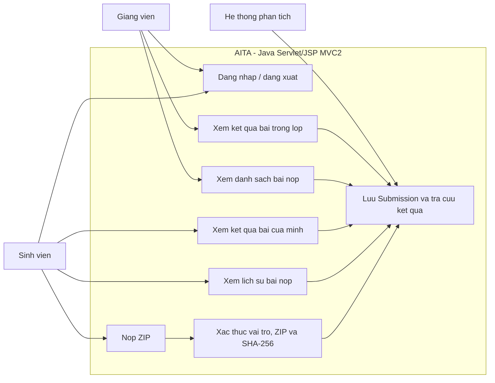

# TV4 - Wireframe va Use-case Submission Portal

## Pham vi va stack trinh dien

Day la giao dien web chinh cho demo PRJ301, dung Servlet/JSP, MVC2, JSTL/EL va JDBC. Route Servlet chuan la `/login`, `/home`, `/student/submissions`, `/student/analysis`, `/teacher/dashboard`, va `/teacher/analysis`. Cac trang JSP nam trong `WEB-INF/views` de khong the truy cap truc tiep.

`portal-node/` la prototype/tich hop Node rieng, khong phai entrypoint cua luong MVC2 trong tai lieu nay.

## Wireframe - dang nhap

```text
+----------------------------------------------------+
| AITA                                  [VI | EN]     |
|----------------------------------------------------|
|              Dang nhap vao AITA                    |
|                                                    |
|  Ten dang nhap  [____________________________]     |
|  Mat khau       [____________________________]     |
|                                                    |
|                   [ Dang nhap ]                    |
|  [Thong bao loi dang nhap neu co]                  |
+----------------------------------------------------+
```

## Wireframe - trang chu theo vai tro

```text
Sinh vien                                  Giang vien
+--------------------------------------+  +--------------------------------------+
| AITA | Xin chao, <ten> | Dang xuat  |  | AITA | Xin chao, <ten> | Dang xuat  |
|--------------------------------------|  |--------------------------------------|
| Bai nop cua toi                      |  | Bang dieu khien giang vien           |
| Nop ZIP, theo doi trang thai,        |  | Duyet bai nop va xem phan tich       |
| xem loi va goi y sua.                |  | cua sinh vien trong lop.             |
| [ Mo bai nop cua toi ]               |  | [ Mo bang dieu khien ]               |
+--------------------------------------+  | Tong quan: Users / Submissions/...  |
                                          +--------------------------------------+
```

## Wireframe - sinh vien nop bai va xem lich su

```text
+--------------------------------------------------------------------------------+
| AITA | Trang chu | Dang xuat                                                   |
|--------------------------------------------------------------------------------|
| Nop bai lap trinh                                                              |
| Chon ZIP <= 10 MB   [ Chon tep... ] [ Nop bai ]                               |
| [Thong bao dang tai / thanh cong / ZIP sai / bai nop trung]                    |
|--------------------------------------------------------------------------------|
| Lich su bai nop cua ban                                                        |
| Ma bai nop       Trang thai       Thoi gian             Ket qua                 |
| SUB-...          Submitted        ...                   [ Xem ket qua ]         |
+--------------------------------------------------------------------------------+
```

Sau khi upload thanh cong, mot dong lich su moi duoc chen len dau bang va form duoc xoa du lieu. Request trung SHA-256 hien thong bao trung va khong tao dong moi.

## Wireframe - dashboard ket qua AST

```text
+--------------------------------------------------------------------------------+
| AITA | Quay lai danh sach                                                     |
|--------------------------------------------------------------------------------|
| Ket qua phan tich AST - SUB-... - Submitted                                    |
| Nhan xet AI: ...                                                               |
| 3 van de duoc phat hien                                                       |
|--------------------------------------------------------------------------------|
| Loi/quy tac | Muc do | Tep va dong | Mo ta va goi y sua                       |
| Null check  | High   | Main.java:12| Kiem tra null truoc khi goi method       |
| ...                                                                            |
| [Xem AST JSON]                                                                 |
+--------------------------------------------------------------------------------+
```

Neu chua co ket qua, thay bang loi bang thong diep "Bai nop chua co ket qua phan tich"; khong gia lap rang upload tu dong chay Analyzer.

## Wireframe - danh sach cua giang vien

```text
+--------------------------------------------------------------------------------+
| AITA | Trang chu | Dang xuat                                                   |
|--------------------------------------------------------------------------------|
| Bang dieu khien giang vien                                                     |
| Ma bai nop | Ma sinh vien | Trang thai | Thoi gian | Phan tich                 |
| SUB-...    | HE...        | Graded     | ...       | [ Xem ket qua ]           |
+--------------------------------------------------------------------------------+
```

Giang vien duoc xem phan tich cua moi bai trong danh sach. Sinh vien chi duoc xem bai co `user_id` trung voi ID trong session.

## Use-case diagram



## Mo ta use-case chinh

| Use-case | Tac nhan | Tien dieu kien | Ket qua / nhanh loi |
|---|---|---|---|
| Dang nhap | Sinh vien, giang vien | Tai khoan hop le trong Users | Tao HttpSession, dieu huong `/home`; sai mat khau hien thong bao va khong tao session. |
| Nop ZIP | Sinh vien | Da dang nhap voi role Student | Filter xac thuc session/role, kiem tra ten va kich thuoc, tinh SHA-256; Servlet kiem tra ZIP an toan, chan file trung, luu Submission. |
| Xem lich su | Sinh vien | Da dang nhap voi role Student | Chi hien cac Submission cua user hien tai. |
| Xem ket qua ca nhan | Sinh vien | Bai nop thuoc user hien tai | Hien AST, severity, tep/dong va goi y; bai khong thuoc user tra 404, chua phan tich hien trang thai cho. |
| Duyet bai nop | Giang vien | Da dang nhap voi role Teacher | Hien danh sach bai nop; role Student truy cap route nay bi Filter tu choi. |
| Xem ket qua cua lop | Giang vien | Bai nop ton tai | Hien ket qua cho bai duoc chon; sinh vien khong the dung route teacher de vuot quyen. |
| Dang xuat | Sinh vien, giang vien | Co session | Huy session va quay ve `/login`. |

## Luong MVC2 va bao mat

1. Trinh duyet gui request toi Servlet Controller, khong mo JSP trong `WEB-INF` truc tiep.
2. `SubmissionSecurityFilter` kiem tra session ID khop voi `currentUser` va role dung theo route.
3. Voi POST upload, Filter kiem tra multipart, file ZIP va kich thuoc; tinh SHA-256 va gan request attribute.
4. `SubmissionController` doc lai Part, xac minh ZIP-slip/zip-bomb, kiem tra trung hash qua DAO va luu artifact.
5. Controller nap Model/DAO va forward toi JSP; JSP chi render du lieu bang EL/JSTL va `c:out`.
